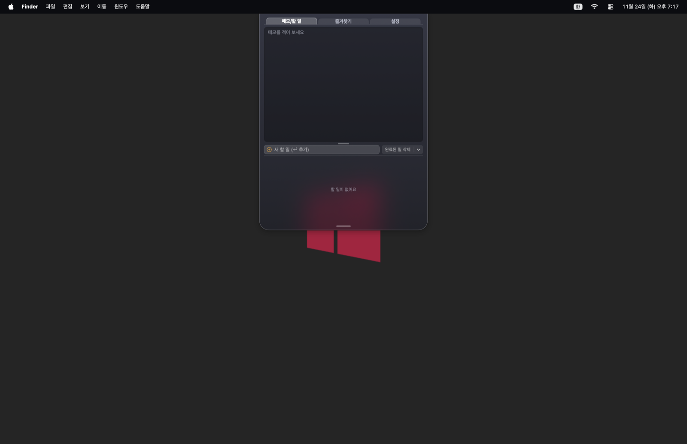
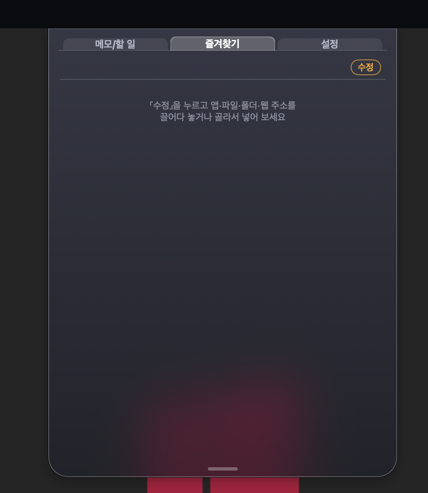
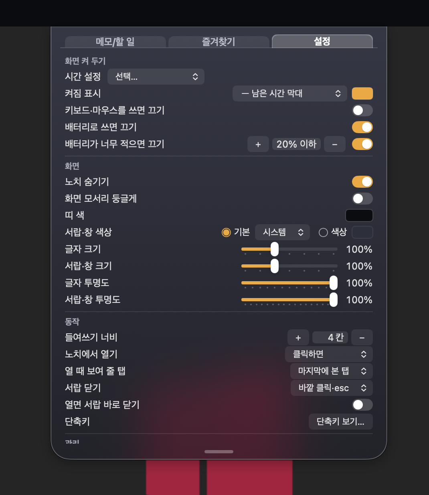

# TopTiroir

[English](README.md) · [한국어](README.ko.md)

노치가 있는 맥북을 위한 작은 메뉴막대 도우미예요. 노치를 검은 띠로 가려 사라지게 하고, 노치를 누르면(또는 단축키) 메모·할 일·즐겨찾기가 든 유리 패널 **서랍**이 내려와요.

> 상태: v1.0, 개인 프로젝트. Swift(SwiftUI + AppKit)와 Apple 기본 프레임워크만 쓰고, 외부 패키지는 없어요.

## 화면



<p>
  
  
</p>

## 기능

- **노치 숨기기** — 메뉴막대 위에 검은 띠를 얹어 노치가 베젤에 묻히게 해요. 화면 모서리 둥글게, 띠 색 설정이 있어요.
- **서랍** — 노치 클릭(또는 마우스 올리기)·`F12`·전역 단축키로 열고, 바깥 클릭이나 `esc`로 닫아요. 책갈피 탭 3개.
- **메모/할 일** — 한 탭에 메모와 할 일 목록. Tab 들여쓰기, 체크, 더블클릭 고치기, 끌어서 순서 바꾸기, 어느 앱에서든 빠른 메모(`⌃⌥M`).
- **즐겨찾기** — 앱·파일·Finder 폴더·웹 주소를 내 폴더(최대 3단계)로 정리해요. Finder·브라우저에서 끌어 넣기, 수정 모드, 「열면 서랍 바로 닫기」 설정.
- **화면 켜 두기** — 계속 / 일정 시간 / 시각까지. 키보드·마우스를 쓰거나 배터리로 바뀌거나 배터리가 적으면 자동으로 꺼요. 메뉴막대 아래에 남은 시간 막대를 보여 줘요.
- **꾸미기** — 창 크기, 글자 크기, 창·글자 투명도, 라이트/다크/직접 고른 색, 들여쓰기 폭, 처음 열 탭.
- **백업** — 메모·즐겨찾기를 JSON 한 파일로 내보내기/가져오기. 비우기·가져오기 직전 상태는 자동으로 한 번 백업해요.
- **한국어·영어** 화면(시스템 언어를 따라가고, 한국어가 아니면 영어).

## 필요한 환경

- macOS 26 이상, Apple Silicon(arm64)
- Xcode(빌드용), [XcodeGen](https://github.com/yonaskolb/XcodeGen) (`brew install xcodegen`)

## 빌드와 설치

```bash
git clone <이 저장소>
cd TopTiroir
./Tools/install.sh        # 테스트 → Release 빌드 → /Applications에 설치 → 실행
```

옵션: `--skip-tests`, `--keep-build`. Xcode가 기본 위치에 없으면 먼저 `DEVELOPER_DIR`를 지정하세요.

개발판만 빌드해서 실행하려면:

```bash
xcodegen generate
xcodebuild -project TopTiroir.xcodeproj -scheme TopTiroir -derivedDataPath ./build build
open build/Build/Products/Debug/TopTiroirDev.app
```

개발판(`TopTiroir Dev`, 번들 ID `…app.dev`)은 설정과 저장 폴더가 따로라서 실제 메모를 건드리지 않아요.

앱은 ad-hoc 서명이고 공증은 받지 않았어요. 처음에 macOS가 막으면 **시스템 설정 → 개인정보 보호 및 보안**에서 **그래도 열기**를 누르세요.

## 기본 단축키

| 동작 | 키 |
|---|---|
| 서랍 열기·닫기 | `F12` |
| 빠른 메모(어느 앱에서든) | `⌃⌥M` |
| 탭 이동: 메모/할 일 · 즐겨찾기 · 설정 | `F1` · `F2` · `F3` |
| 서랍 닫기 · 고치기 취소 | `esc` |
| 종료 | `⌘Q`(서랍이 열려 있을 때) |

`esc`를 뺀 모든 키는 **설정 → 단축키 보기…**에서 바꿀 수 있어요.

## 권한과 개인정보

- **네트워크를 쓰지 않아요.** 아무것도 밖으로 보내지 않아요.
- 메모와 즐겨찾기는 `~/Library/Application Support/TopTiroir/`에만 저장해요(폴더 `700`, 파일 `600`).
- 손쉬운 사용·화면 기록 같은 특별한 권한이 필요 없어요.
- 앱 자체의 Dock·메뉴막대 아이콘은 없고, 모든 조작은 서랍에서 해요(설정에서 60초간 임시 아이콘을 보일 수 있어요).

## 알려진 한계

- 전체 화면 앱에서는 검은 띠가 보이지 않아요.
- 로그인 자동 실행은 앱이 `/Applications`에 있을 때 가장 안정적이에요.

## 폴더 구성

```
project.yml            XcodeGen 설정(.xcodeproj는 여기서 생성)
TopTiroir/
  App/  Core/  Screen/  Drawer/  Notes/  Favorites/  KeepAwake/  System/
  Resources/Localizable.xcstrings   영어 번역
TopTiroirTests/        Swift Testing 단위 테스트(계산 로직은 Core/에)
Tools/install.sh       테스트 → 빌드 → 설치
DEVLOG.md              개발 기록(한국어 원본, 영어판 DEVLOG.en.md)
docs/                  기술 노트(한국어·영어)
```

## 라이선스

[MIT](LICENSE)
