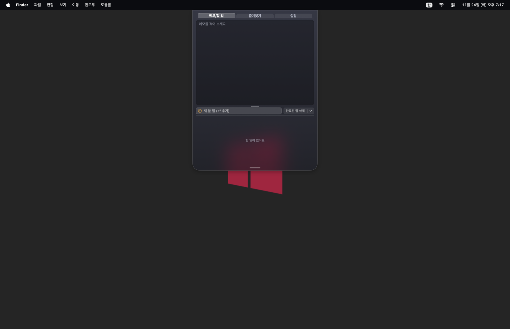
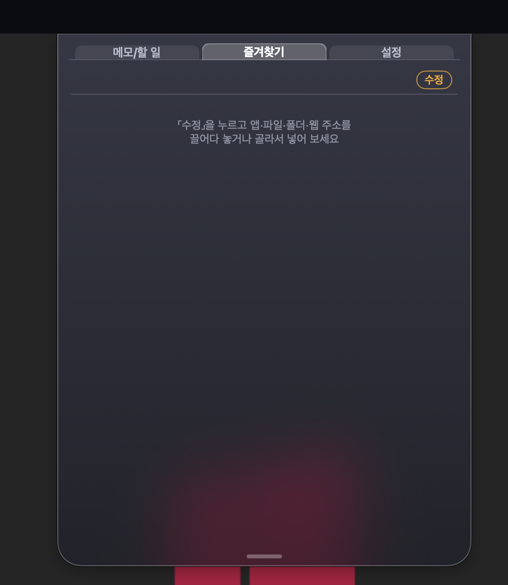
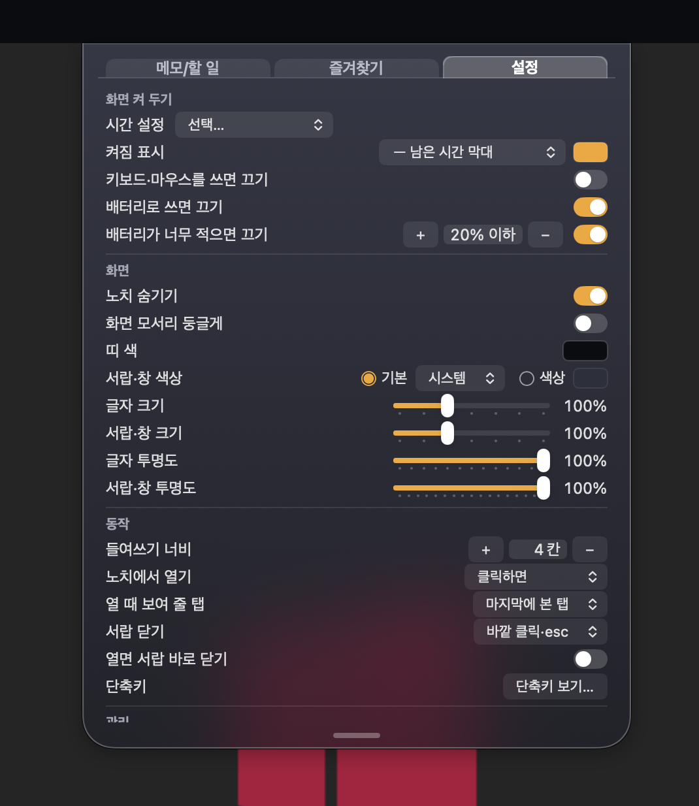

# TopTiroir

[English](README.md) · [한국어](README.ko.md)

A small menu-bar helper for MacBooks with a notch. TopTiroir hides the notch behind a black band and turns it into a **drawer** — click the notch (or press a key) and a glass panel slides down with your quick notes, to-dos, and favorites.

> Status: v1.0, personal project. Built with Swift (SwiftUI + AppKit) and Apple frameworks only — no third-party packages.

## Screenshots

*The UI follows the system language; these screenshots show the Korean UI.*



<p>
  
  
</p>

## Features

- **Notch hiding** — a black band over the menu bar makes the notch disappear into the bezel. Optional rounded screen corners and band color.
- **Drawer** — opens from the notch (click or hover), `F12`, or a global shortcut. Closes on outside click or `esc`. Three bookmark-style tabs.
- **Notes / To-dos** — a memo and a to-do list in one tab. Indent with Tab, check items off, double-click to edit, drag to reorder, quick memo shortcut (`⌃⌥M`) from any app.
- **Favorites** — apps, files, Finder folders, and web links, organized in your own folders (up to 3 levels). Drag in from Finder or a browser, edit mode, optional "close drawer after opening".
- **Keep screen awake** — until you stop it, for a set time, or until a clock time; auto-off on keyboard/mouse use, on battery, or at low battery. Shows a small progress bar under the menu bar.
- **Customizable look** — window size, text size, window/text opacity, light/dark/custom color, indent width, which tab opens first.
- **Backup** — export / import notes and favorites as one JSON file; the last clear/replace is backed up automatically.
- **English and Korean** UI (follows the system language; anything other than Korean shows English).

## Requirements

- macOS 26 or later, Apple Silicon (arm64)
- Xcode (to build) and [XcodeGen](https://github.com/yonaskolb/XcodeGen) (`brew install xcodegen`)

## Build & install

```bash
git clone <this repository>
cd TopTiroir
./Tools/install.sh        # runs tests, builds Release, installs to /Applications, opens the app
```

Options: `--skip-tests`, `--keep-build`. If Xcode is not in the default location, set `DEVELOPER_DIR` first.

To build and run the development version only:

```bash
xcodegen generate
xcodebuild -project TopTiroir.xcodeproj -scheme TopTiroir -derivedDataPath ./build build
open build/Build/Products/Debug/TopTiroirDev.app
```

The development build (`TopTiroir Dev`, bundle ID `…app.dev`) keeps its own settings and its own data folder, so it never touches your real notes.

The app is ad-hoc signed (not notarized). The first time, macOS may block it: open **System Settings → Privacy & Security** and choose **Open Anyway**.

## Default shortcuts

| Action | Key |
|---|---|
| Open / close drawer | `F12` |
| Quick memo (from any app) | `⌃⌥M` |
| Tabs: Notes · Favorites · Settings | `F1` · `F2` · `F3` |
| Close drawer / cancel edit | `esc` |
| Quit | `⌘Q` (while the drawer is open) |

All of these except `esc` can be changed in **Settings → View shortcuts…**.

## Permissions & privacy

- **No network access.** Nothing is sent anywhere.
- Notes and favorites are stored locally in `~/Library/Application Support/TopTiroir/` (folder `700`, files `600`).
- No special permissions (Accessibility, Screen Recording, etc.) are needed.
- The app has no Dock or menu bar icon of its own; everything is done from the drawer (a temporary menu bar icon can be shown for 60 seconds from Settings).

## Known limitations

- Full-screen apps cover the black band.
- Launch at login works best when the app is in `/Applications`.

## Project layout

```
project.yml            XcodeGen configuration (the .xcodeproj is generated)
TopTiroir/
  App/  Core/  Screen/  Drawer/  Notes/  Favorites/  KeepAwake/  System/
  Resources/Localizable.xcstrings   English translations
TopTiroirTests/        Swift Testing unit tests (pure logic lives in Core/)
Tools/install.sh       test → build → install
DEVLOG.en.md           development log (English; DEVLOG.md is the Korean original)
docs/                  tech notes (English and Korean)
```

## License

[MIT](LICENSE)
